# SCSVMV Log Book — POC User Guide

**Application:** SCSVMV-LOG-BOOK  
**Version:** POC (2026)  
**Production URL:** https://logbook.kanchiuniv.ac.in  
**Default academic period:** 2026-2027 · Odd semester  

---

## Table of Contents

1. [Introduction](#1-introduction)
2. [User Roles](#2-user-roles)
3. [Login & Access](#3-login--access)
4. [Faculty Dashboard](#4-faculty-dashboard)
5. [Workload](#5-workload)
6. [Lecture Plan](#6-lecture-plan)
7. [Tests](#7-tests)
8. [Assignments](#8-assignments)
9. [Extra Classes](#9-extra-classes)
10. [Theory Assessment](#10-theory-assessment)
11. [Practical Assessment](#11-practical-assessment)
12. [Inspections](#12-inspections)
13. [Profile](#13-profile)
14. [Admin / HOD Dashboard](#14-admin--hod-dashboard)
15. [Logbook Lock](#15-logbook-lock)
16. [CSV Import Guide](#16-csv-import-guide)
17. [Troubleshooting](#17-troubleshooting)

---

## 1. Introduction

The **SCSVMV Log Book** is a digital faculty logbook for Sri Chandrasekharendra Saraswathi Viswa Mahavidyalaya (SCSVMV). Faculty use it to record and manage:

- Weekly teaching workload
- Lecture plans and topic completion
- Tests and assignments
- Extra classes
- Theory and practical assessments
- Inspection submissions for HOD / Dean approval

All data is scoped by **Academic Year** and **Semester (Odd/Even)** so previous-year records stay separate from the current period.

---

## 2. User Roles

| Role | Login page | Purpose |
|------|------------|---------|
| **Staff** | `/login` → Staff tab | Faculty logbook entry |
| **Supervisor** | `/login` → Supervisor tab | Supervisory access |
| **Officer (HOD/Dean)** | `/officer-login` | Admin inspection dashboard |
| **Admin** | `/admin-login` | HOD / Dean dashboard with staff reports |

---

## 3. Login & Access

### 3.1 Staff / Supervisor Login

1. Open https://logbook.kanchiuniv.ac.in/login (or `http://localhost:3000/login` locally).
2. Select **Staff** or **Supervisor**.
3. Enter your **LMS User ID** and **Password**.
4. Solve the **Security Check** (math captcha).
5. Click **Sign In**.

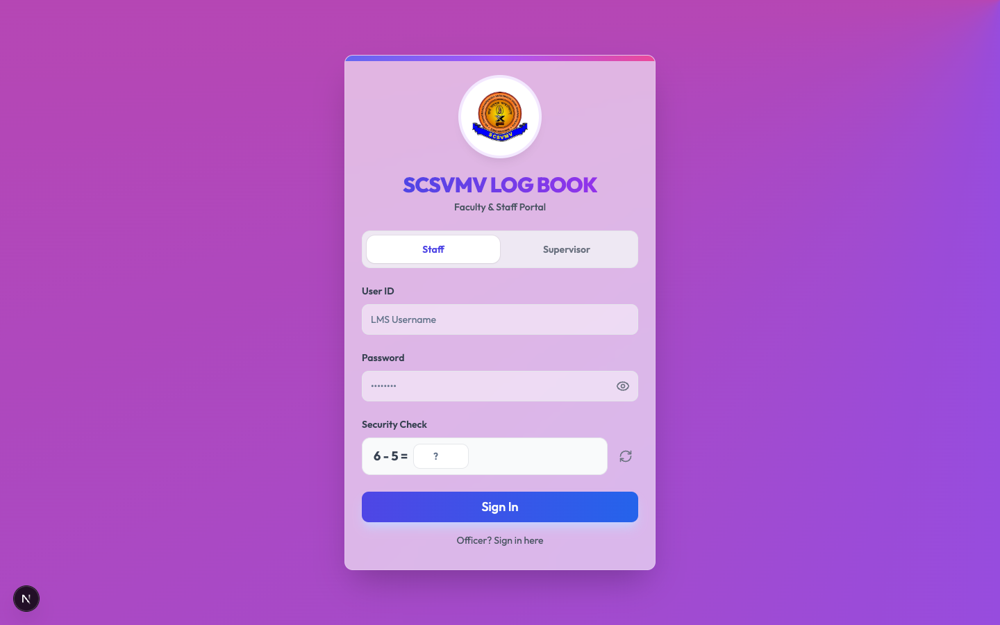

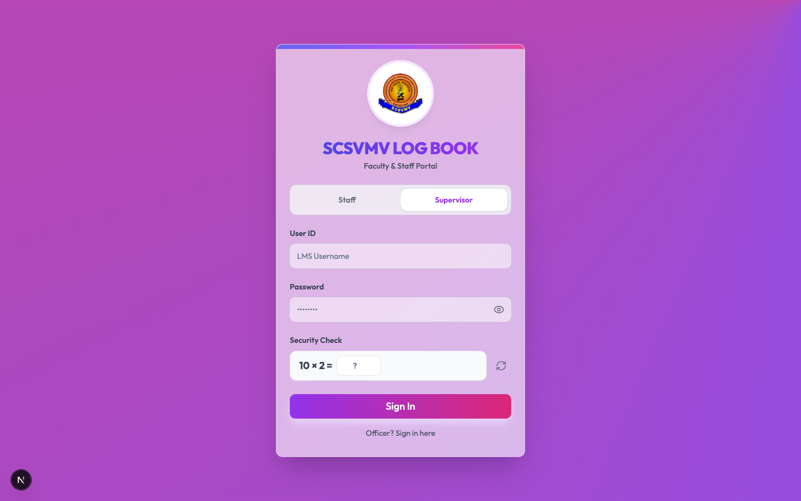

### 3.2 Officer Login (HOD / Dean)

1. Open `/officer-login` or click **Officer? Sign in here** on the main login page.
2. Enter Officer User ID and Password.
3. Complete the security check and sign in.

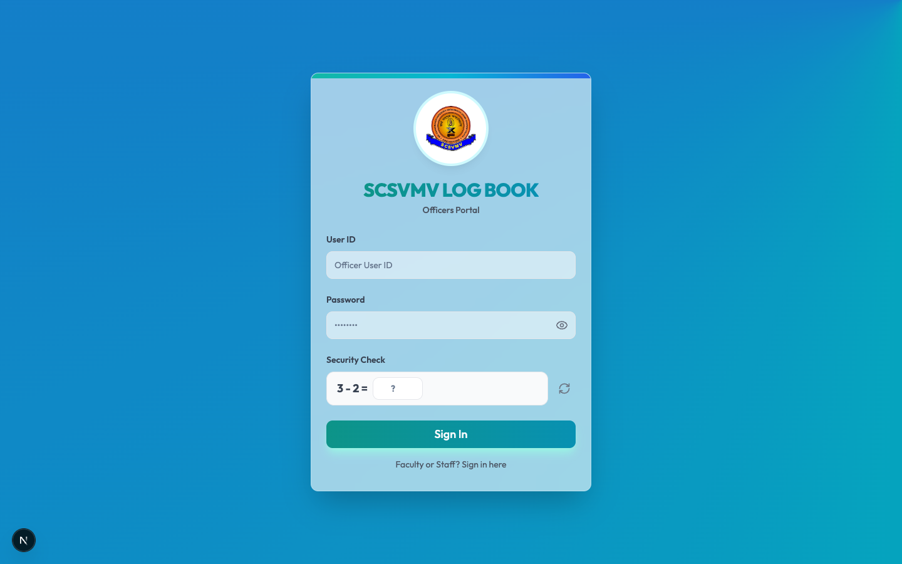

### 3.3 Admin Login

1. Open `/admin-login`.
2. Enter User ID, Password, and select **User Type** (HOD / Dean).
3. Click **Login to Dashboard**.

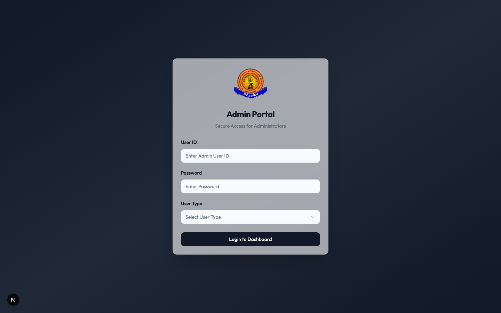

### 3.4 Forgot Password

1. From the login page, use the forgot-password link or open `/forgot-password`.
2. Select **Staff** or **Supervisor**.
3. Enter User ID or Email and click **Send Credentials**.

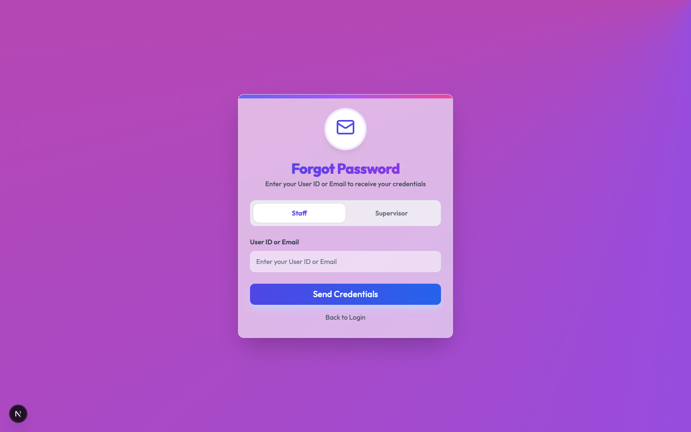

---

## 4. Faculty Dashboard

**Path:** `/dashboard`

After login, the dashboard gives a complete snapshot of your logbook for the current academic period.

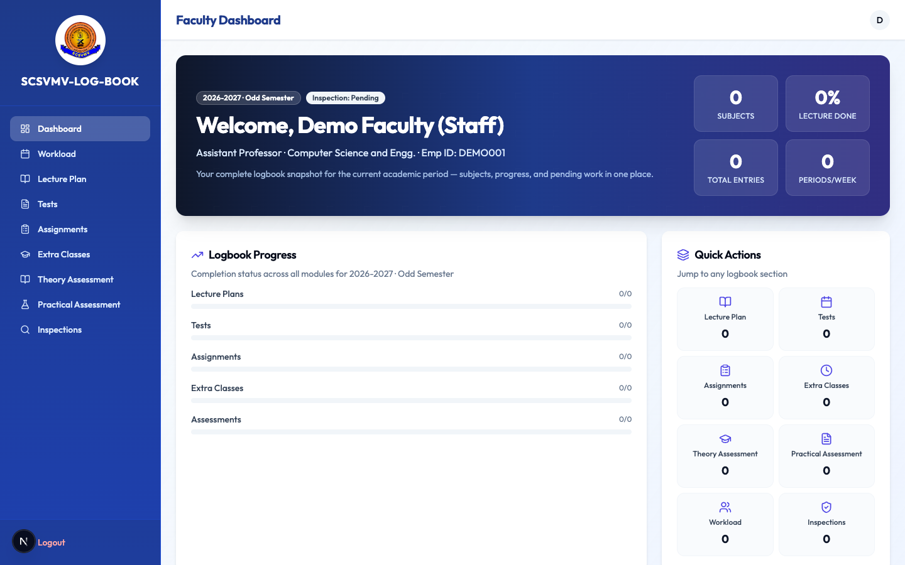

### What you see

| Section | Description |
|---------|-------------|
| **Welcome hero** | Your name, department, designation, Emp ID, academic period |
| **Summary tiles** | Subjects count, lecture completion %, total entries, weekly periods |
| **Logbook progress** | Progress bars for Lecture Plans, Tests, Assignments, Extra Classes, Assessments |
| **Quick actions** | One-click links to every module with live counts |
| **Subject table** | Per-subject lecture / test / assignment / extra-class counts |
| **Pending panel** | Incomplete lecture topics and upcoming tests |
| **Module cards** | Quick links to open each section |

### How to use

1. Review overall progress at the top.
2. Check **My Subjects** for subject-wise status.
3. Open **Pending & Upcoming** for work that needs attention.
4. Click any **Quick Action** or **Module Summary** card to go directly to that module.

---

## 5. Workload

**Path:** `/workload`

Records your weekly teaching schedule for the selected academic year and semester.

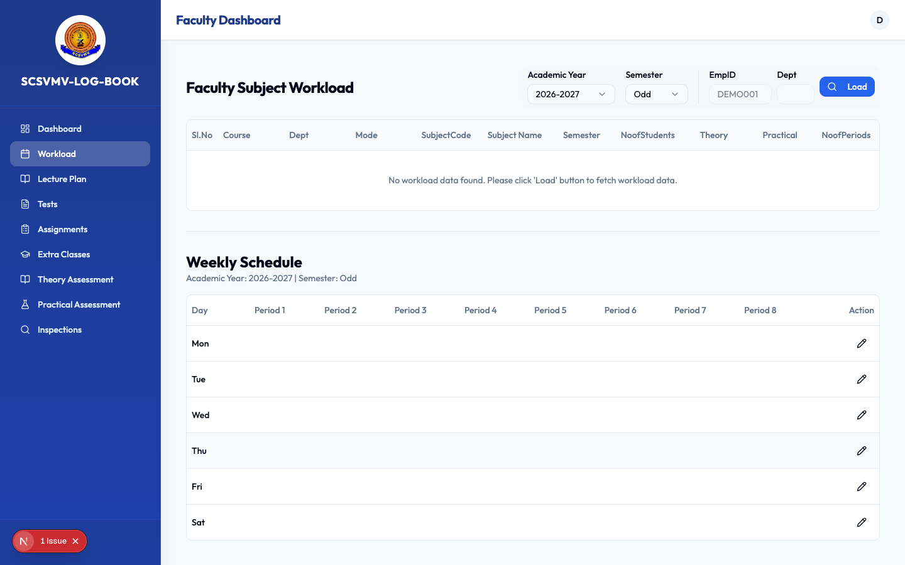

### Steps

1. Open **Workload** from the sidebar.
2. Select **Academic Year** (default: 2026-2027) and **Semester** (Odd/Even).
3. View subjects loaded from the university workload API.
4. Fill in the **weekly schedule grid** (Mon–Sat, periods 1–8) for each subject/section.
5. Click **Save** to store your timetable.

### Notes

- Workload is filtered by academic year and semester.
- Subject list comes from the official faculty workload system.

---

## 6. Lecture Plan

**Path:** `/lecture-plan`

Plan and track lecture topics with proposed and actual completion dates.

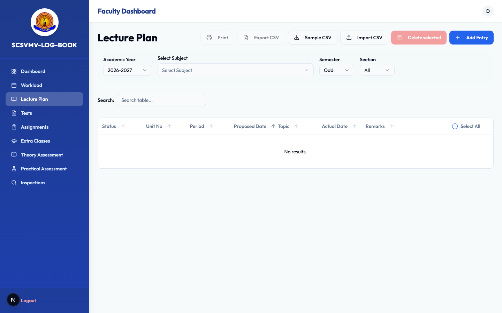

### Steps

1. Open **Lecture Plan**.
2. Select **Academic Year** and **Semester**.
3. Select **Subject** (required — no “All subjects” default).
4. Optionally filter by **Section**.
5. View the topic list with **Status** (Pending / Completed).

### Add / Edit / Delete

- **Add Entry** — open the form and enter unit, period, proposed date, topic, remarks.
- **Edit** — click the pencil icon on a row.
- **Delete** — click the trash icon (confirm when prompted).
- **Mark completed** — tick the checkbox; set **Actual Date** (proposed date or T+1 rule applies).

### CSV Import / Export

| Button | Action |
|--------|--------|
| **Sample CSV** | Download template |
| **Import CSV** | Bulk upload (subject must be selected first) |
| **Export CSV** | Download current table data |
| **Print** | Print-friendly view |

### CSV columns

`unit_no`, `period_no`, `proposed_date`, `topic`, `remarks`  
*(Do not include `actual_completion_date` in import — use the UI checkbox after import.)*

### Date rules

- **Actual date** = proposed date or next day (T+1) only.
- Completion must fall within the allowed window for the proposed date.

---

## 7. Tests

**Path:** `/tests`

Schedule and record class tests.

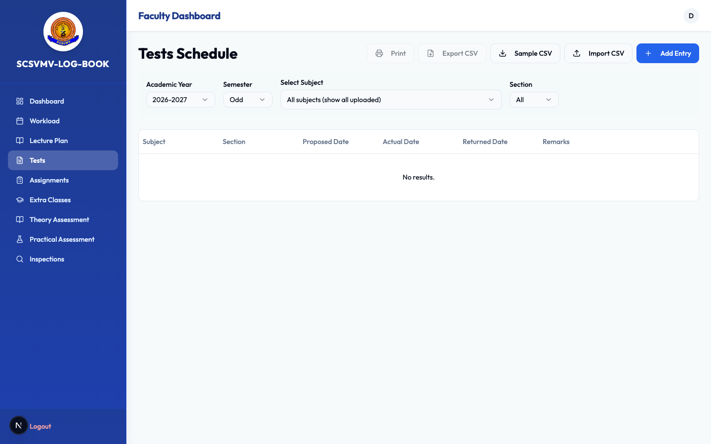

### Steps

1. Open **Tests**.
2. Select **Academic Year**, **Semester**, and **Subject**.
3. View tests for the current period only (old year data is hidden).

### Add / Edit / Delete

- **Add Entry** — enter proposed test date, actual date, returned date, remarks.
- **Edit / Delete** — use row action icons.

### CSV

- Download **Sample CSV**, fill in data, click **Import CSV**.
- Subject and section must be selected before import.

### CSV columns

`proposed_test_date`, `actual_date`, `date_returned`, `remarks`

---

## 8. Assignments

**Path:** `/assignments`

Record home assignments and lab records.

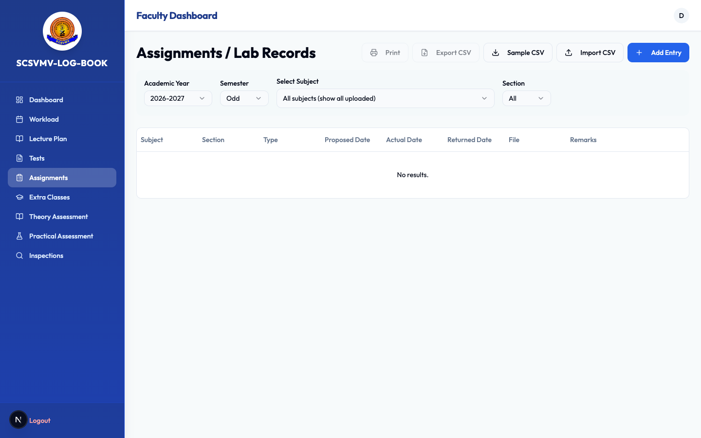

### Steps

1. Open **Assignments**.
2. Select **Academic Year**, **Semester**, and filters.
3. Use **All subjects** or pick a specific subject to filter the table.

### Fields

| Field | Description |
|-------|-------------|
| Subject | From workload |
| Section | Class section |
| Type | e.g. Home Assignment |
| Proposed Date | Planned date |
| Actual Date | Conducted date |
| Returned Date | Papers returned |
| File | Optional upload |
| Remarks | e.g. Completed |

### CSV columns

`type`, `proposed_date`, `actual_date`, `date_returned`, `remarks`

---

## 9. Extra Classes

**Path:** `/extra-classes`

Log extra / remedial / special classes.

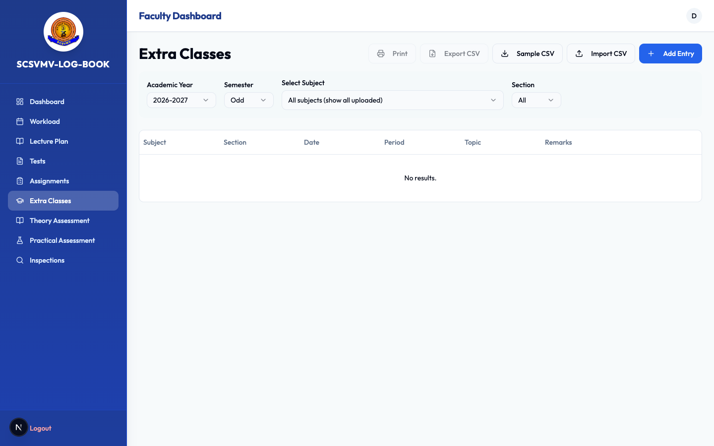

### Steps

1. Open **Extra Classes**.
2. Select academic period and subject filters.
3. Add entries with **Date**, **Period**, **Topic**, and **Remarks**.

### CSV columns

`date`, `period`, `topic`, `remarks`

---

## 10. Theory Assessment

**Path:** `/assessment/theory`

Enter internal assessment marks for theory subjects.

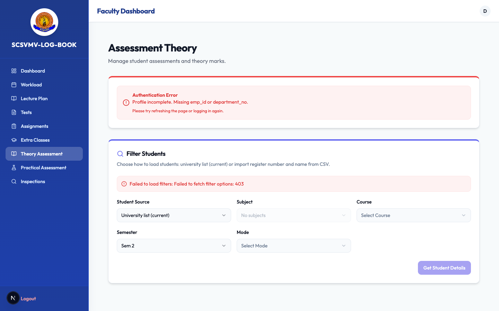

### Load students

**Option A — University list (current)**

1. Select **Student Source:** University list (current).
2. Select **Subject**, **Course**, **Semester**, **Mode**.
3. Click **Get Student Details**.

**Option B — Import CSV**

1. Select **Student Source:** Import CSV (Register No + Name).
2. Select **Subject**.
3. Click **Sample CSV** to download template.
4. Click **Import Students CSV** and upload your file.

**CSV format:** `registrationno`, `name`, `section` (optional)

Once imported, the student list is **saved automatically** — you do not need to re-import each visit.

### Enter marks

| Column | Max marks |
|--------|-----------|
| Internal Test 1 | 15 |
| Internal Test 2 | 15 |
| Assignment & Attendance | 10 |
| **Total** | **40** (auto-calculated) |

### Steps

1. Load or import students.
2. Select students using checkboxes.
3. Click **Edit Marks** and enter values inline, **or** click **Save Assessment** for bulk entry.
4. Click **Save Marks** to store in the database.

### Manage student list (import mode)

| Action | Button |
|--------|--------|
| Add one student | **Add** / **Add Student** |
| Remove selected | **Delete (N)** |
| Remove one row | Trash icon on row |
| Replace full list | **Re-import CSV** |

---

## 11. Practical Assessment

**Path:** `/assessment/practical`

Same workflow as Theory Assessment, with practical mark columns.

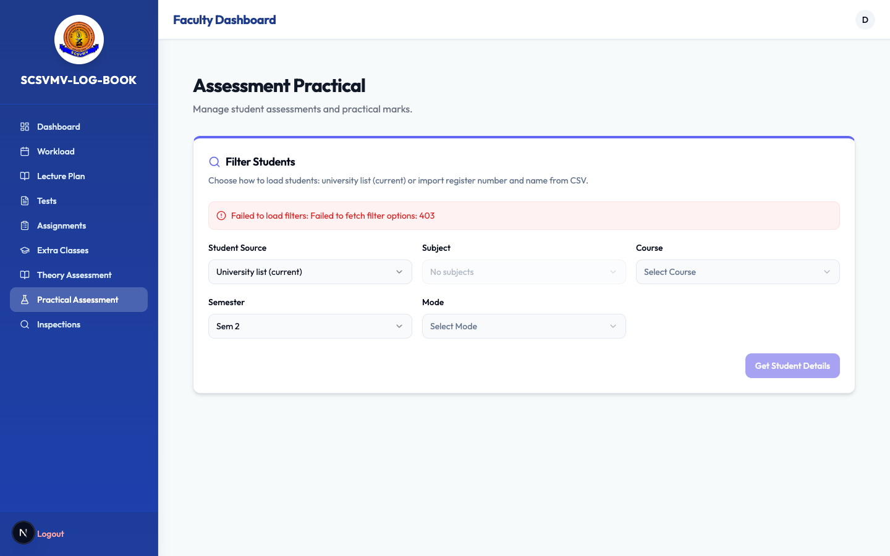

### Mark columns

| Column | Max marks |
|--------|-----------|
| Observations | 15 |
| Model Test | 15 |
| Record & Attendance | 10 |
| **Total** | **40** |

Student import, roster persistence, add/delete, and CSV re-import work the same as Theory Assessment.

---

## 12. Inspections

**Path:** `/inspections`

Submit your logbook for HOD / Dean inspection.

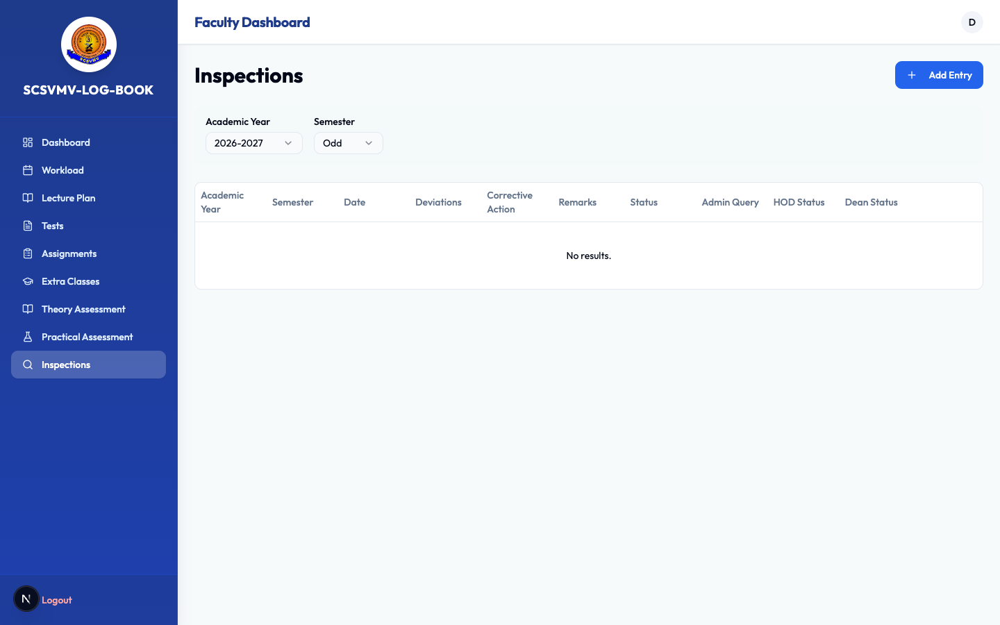

### Steps

1. Open **Inspections**.
2. Select **Academic Year** and **Semester**.
3. Click **Add Entry** to create an inspection record.
4. Fill in **Date**, **Deviations**, **Corrective Action**, **Remarks**.
5. Upload **HOD** and **Dean** signature images if required.
6. Click **Submit to HOD** when the logbook is ready.

### Status flow

```
Pending → Submitted → HOD Approved → Dean Approved
                ↓
            Returned (with query — logbook unlocks for edits)
```

After **Submit**, the logbook is **locked** for that academic period until HOD returns it with a query.

---

## 13. Profile

**Path:** `/profile`

View your faculty profile synced from the university system (name, department, designation, Emp ID, contact details).

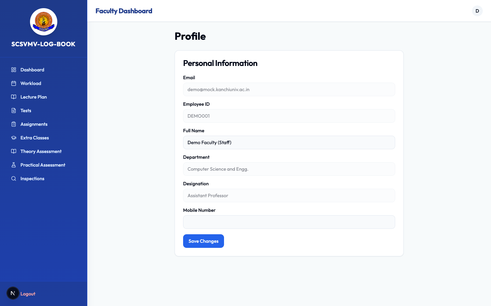

---

## 14. Admin / HOD Dashboard

**Path:** `/admin`

For HOD and Dean officers after admin login.

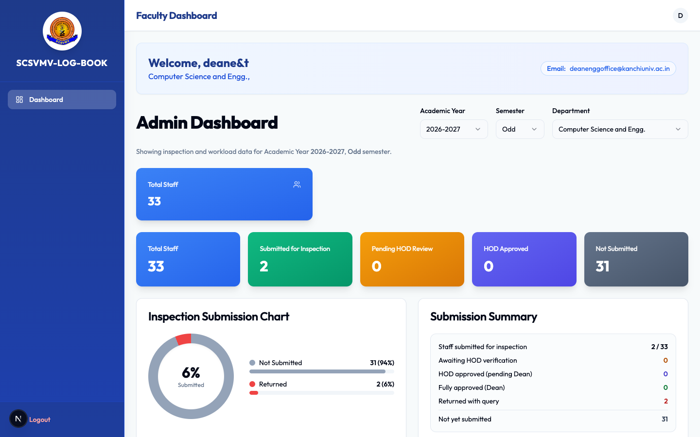

### Features

- Select **Academic Year** and **Semester** to filter reports.
- View all staff under supervision.
- Open staff detail: workload, lecture plans, tests, assignments, inspections.
- **Verify** or **Return** inspection submissions.
- Dean final approval after HOD verification.

---

## 15. Logbook Lock

When an inspection is **Submitted**, **HOD Approved**, or **Dean Approved** for a given academic year and semester:

- Lecture Plan, Tests, Assignments, Extra Classes, and Assessments become **read-only** for that period.
- A yellow **Logbook Locked** banner appears on affected pages.
- Other academic periods remain editable.

If HOD **Returns** the inspection with a query, editing is enabled again until resubmission.

---

## 16. CSV Import Guide

### General rules

1. Always download **Sample CSV** first and match the exact column headers.
2. Select **Subject** (and **Section** where required) before importing.
3. Select **Odd** or **Even** semester — import is blocked when semester is **All**.
4. Dates: use `DD/MM/YYYY` or `YYYY-MM-DD` as shown in the sample file.

### Module summary

| Module | Required columns |
|--------|------------------|
| Lecture Plan | unit_no, period_no, proposed_date, topic, remarks |
| Tests | proposed_test_date, actual_date, date_returned, remarks |
| Assignments | type, proposed_date, actual_date, date_returned, remarks |
| Extra Classes | date, period, topic, remarks |
| Theory/Practical students | registrationno, name, section |

---

## 17. Troubleshooting

| Issue | Solution |
|-------|----------|
| Empty subject dropdown | Check workload API; verify Emp ID and department in profile |
| Old year data showing | Confirm Academic Year and Semester filters; run latest DB migrations |
| Import fails | Match sample CSV headers exactly; select subject and semester first |
| Logbook locked | Check Inspections status; wait for HOD return if query raised |
| Assessment roster not saved | Run migration `20250622_assessment_theory_roster.sql` and `20250622_assessment_practical_roster.sql` in Supabase |
| Cannot sign in | Use Forgot Password; verify LMS credentials and captcha answer |

---

## Database migrations (admin)

Run these in Supabase SQL Editor for full functionality:

| Migration | Purpose |
|-----------|---------|
| `20250617_inspection_academic_period.sql` | Per-period inspection lock |
| `20250617_workload_academic_period.sql` | Workload period scoping |
| `20250618_lecture_plans_academic_period.sql` | Lecture plan period columns |
| `20250618_logbook_academic_period.sql` | Assignments / tests / extra classes periods |
| `20250622_assessment_theory_roster.sql` | Saved theory student lists |
| `20250622_assessment_practical_roster.sql` | Saved practical student lists |

---

## Appendix — Sidebar navigation

| Menu item | URL |
|-----------|-----|
| Dashboard | `/dashboard` |
| Workload | `/workload` |
| Lecture Plan | `/lecture-plan` |
| Tests | `/tests` |
| Assignments | `/assignments` |
| Extra Classes | `/extra-classes` |
| Theory Assessment | `/assessment/theory` |
| Practical Assessment | `/assessment/practical` |
| Inspections | `/inspections` |

---

*Document generated for SCSVMV Log Book POC — August 2026*
